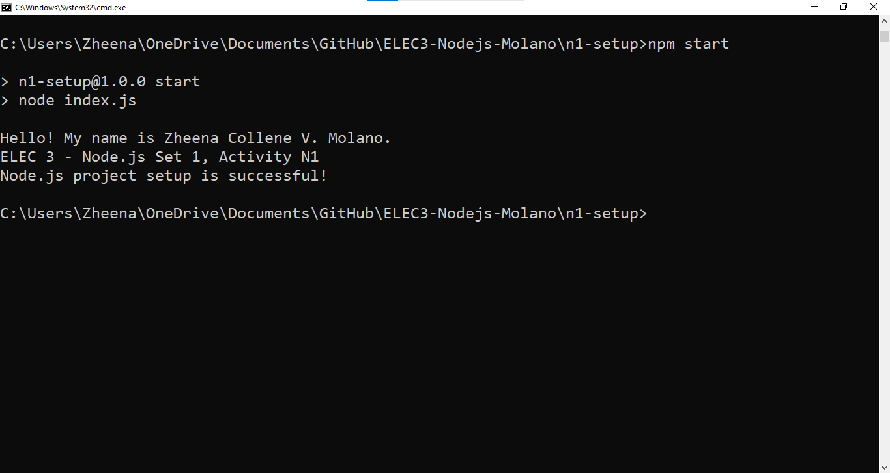
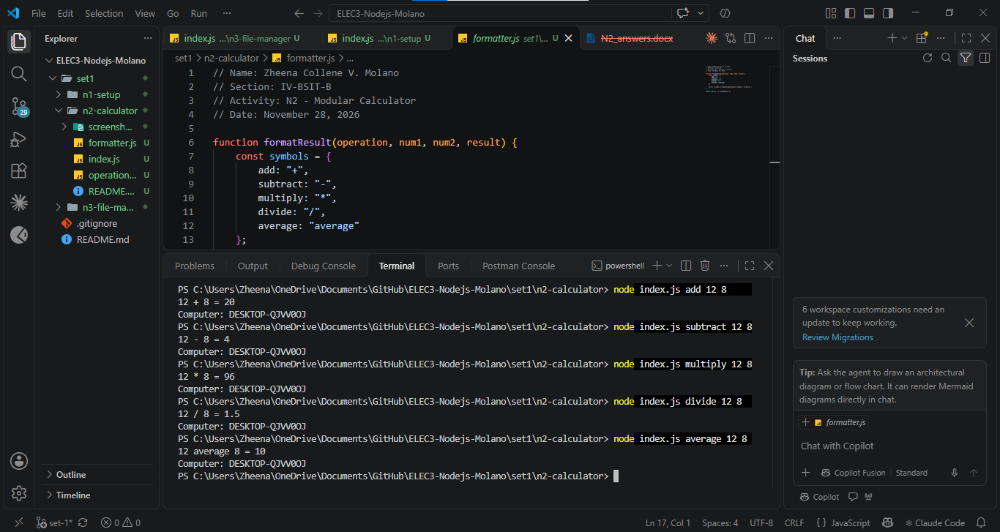
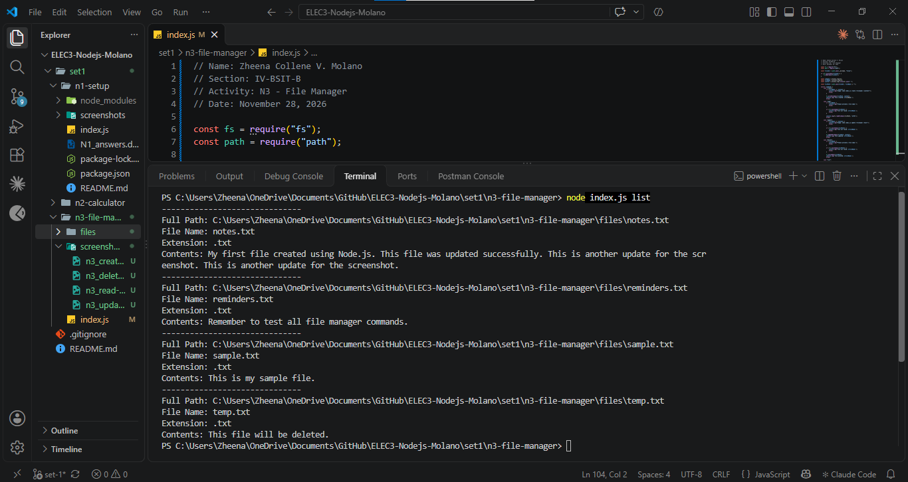

# ELEC3-Nodejs-Molano

**Name:** Zheena Collene V. Molano  
**Section:** IV-BSIT-B  
**Course:** ELEC 3 - Node.js

## Set 1 Activities

### N1 - Project Setup and Package Management

Demonstrates Node.js project setup, npm package installation, and package management.

**Folder:** [n1-setup](set1/n1-setup/)

**Run commands:**
```bash
cd set1/n1-setup
npm install
npm start
```

**Screenshot:**



### N2 - Modular Calculator

Demonstrates a modular calculator using separate JavaScript files for operations and result formatting.

**Folder:** [n2-calculator](set1/n2-calculator/)

**Run commands:**
```bash
cd set1/n2-calculator
node index.js add 12 8
node index.js subtract 12 8
node index.js multiply 12 8
node index.js divide 12 8
node index.js average 12 8
```

**Screenshot:**



### N3 - File Manager

Demonstrates creating, reading, updating, deleting, and listing text files using Node.js.

**Folder:** [n3-file-manager](set1/n3-file-manager/)

**Run commands:**
```bash
cd set1/n3-file-manager
node index.js create notes.txt "Hello Node.js"
node index.js read notes.txt
node index.js update notes.txt " Updated content"
node index.js delete notes.txt
node index.js list
```

**Screenshot:**



## Repository Structure

```text
ELEC3-Nodejs-Molano/
├── README.md
├── .gitignore
└── set1/
    ├── n1-setup/
    ├── n2-calculator/
    └── n3-file-manager/
```